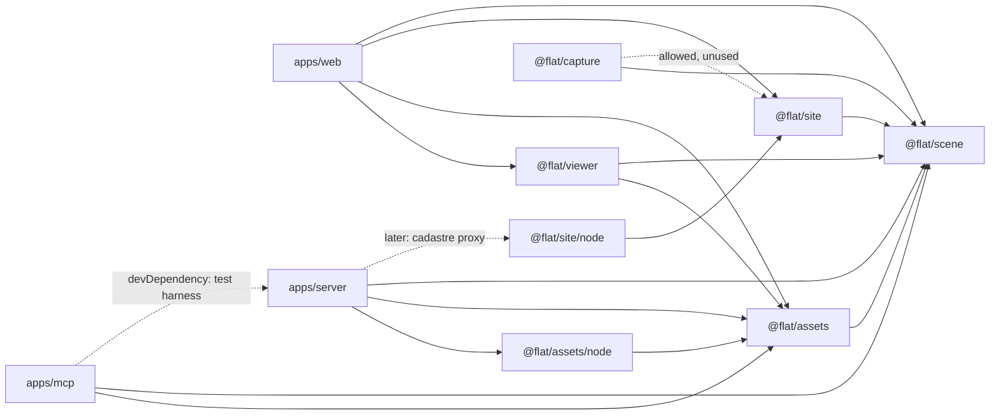

# Module architecture: splitting the 3D flat simulator

> Status: **refactor complete (2026-10-29, step 11 done; see "Step 11 record and final state")**. Originally a proposal (2026-10-28), written after M5 was accepted. Scope: the module split asked for in the M5 acceptance follow-ups. This document is the plan only. It does not implement M6, the cadastre or capture.

## 0. What the code looks like today, and why the split is not a plain file move

The repository has five places that hold code: `packages/scene` (about 120 source files), `apps/web` (UI, the viewer in `src/viewer`, about 70 files and 8.5k lines), `apps/server`, `apps/mcp` and `tools/site-context`. Workspace packages are consumed as TypeScript source (`"main": "src/index.ts"`, `noEmit`, no project references). The only bundle is `apps/web/dist`. The headless renderer in `apps/mcp/src/render` serves that bundle with `?test`.

Exploring the code turned up four couplings that decide the plan:

1. **Scene core depends on the asset code.**
   - `schema.ts` imports `MeshSource` and `checkParametricMesh` from `assets/catalog.ts`.
   - `geometry/shell.ts` calls `buildItems`.
   - `validate.ts`, `describe.ts`, `commands/items.ts`, `commands/item-schema.ts`, `commands/labels.ts`, `placement/{footprint,solve,support,walkways}.ts` and `lighting/lamps.ts` import from `assets/*`.

   So a new `@flat/assets` package cannot depend on `@flat/scene` until the *contracts* are separated from the *implementations* inside scene. The seam already exists: `GENERATORS` is an injectable `GeneratorRegistry` that starts empty and is filled by a side-effect import (`assets/builtin.ts` does `import './generators'`).

2. **The usual shim direction would create a cycle.** If `packages/scene` keeps a shim that re-exports `@flat/assets`, scene depends on assets and assets depends on scene. For anything that leaves `scene`, the plan works **facade first** instead:
   - the new package first re-exports from scene;
   - consumers switch to the new package;
   - then the code moves underneath the facade.

   Shims at the *old* location are only used where the old location is downstream (`apps/web/src/viewer` → `@flat/viewer`, `tools/site-context` → `@flat/site`). Both shims are gone (V8, step 11).

3. **The viewer imports app state.** These imports must be cut before the viewer can be extracted:
   - `PlacementLayer.tsx` imports `catalog/{catalogStore,ghost,placement,snap}`, which imports `state/sceneStore`, which imports `viewer/scene-identity`. That is already a cycle inside the app.
   - `ZoneEditor.tsx` imports `catalog/zone-drag`.
   - `ItemsMesh.tsx` and `model-env.ts` import `sync/sync-store`.
   - `model-env.ts` imports `catalog/format`.
   - `WalkControls.tsx` imports `state/dayClock`.
   - `structural-overlay-store.ts` imports `state/prefs`.
   - `model-env.ts`, `catalog.ts` and `environment.ts` read `import.meta.env.BASE_URL`.

4. **The same code exists in several places.**
   - The catalog-entry key list is written three times: `apps/mcp/src/assetCatalog.ts` (`KEYS`), `apps/web/src/viewer/model-env.ts` (`ASSET_KEYS`) and `apps/server/src/local-assets.ts`.
   - Asset URLs are written twice: `model-env.ts` says it "mirrors `HttpFlatApi.assetUrl`" in `apps/mcp`.
   - The `SiteContext` rules exist as a hand copy (`validateContext` in `tools/site-context/lib.mjs`) and as the zod schema.

   These duplicates are the clearest reason for shared `assets` and `site` packages.

---

## 1. Target package layout

```
packages/
  scene/     @flat/scene     core model: schema, commands, placement, geometry, lighting math, contracts
  assets/    @flat/assets    mesh catalog, generators, item materials, texture library, HD tier, resolution chain,
                             product wire types, caches, URL builders
             @flat/assets/node     node-only: the local 3D-FUTURE pack reader (fs)
  site/      @flat/site      geolocation, ENU projection, BD TOPO context building, the fit tool, contracts for the
                             cadastre and the plan (blueprint) parser
             @flat/site/node       node-only: IGN WFS and geocoder clients, the CLI, retries, file output
  viewer/    @flat/viewer    the react-three-fiber rendering library (FlatCanvas and everything it draws)
             @flat/viewer/testing  test-hook internals (stats, synthetic GLB, model runtime) for apps/web testHook and e2e
  capture/   @flat/capture   placeholder: contracts for importing photos, videos and scans
apps/
  web/       UI shell: panels, catalog UI, editor overlays, stores, sync client, testHook, main.tsx
  server/    Hono scene server, providers (retailers, server-only), products and assets routes, persistence
  mcp/       MCP server, tools, headless render (still serves apps/web/dist)
(tools/site-context was a one-file shim to the @flat/site CLI; removed in step 11, use `pnpm site:context`)
scripts/              unchanged location (materials, models, models-hd, env, ci, mcp-demo); only import paths change
```

The rule behind every split: **`scene` models, satellite packages produce or consume, apps assemble.** Contracts that are stored in a `.flat.json` file, or checked when one is parsed, stay in `scene`. Implementations that only produce or display them move out.

### 1.1 `@flat/scene`: the core model (it shrinks)

**Stays in scene:** `schema`, `parse`, `load`, `validate`, `plan-check`, `plan-fix`, `plan-recess` (plan-coherence lint: pure, fixes are typed `wall.setEnds` / `room.setPolygon` batches), `serialize`, `measure`, `collision`, `camera`, `camera-presets`, `view`, `structural`, `stats`, `describe`, `diff`, `protocol`, `mcp-types`, `bill-of-materials`, `primitives`, `commands/**`, `placement/**`, `geometry/**`, `materials/paint.ts`, `context/{schema,mesh}.ts`, `lighting/**`, `fixtures/**`.

**New `src/items/` folder in scene.** These are the asset contracts a Scene file depends on:

| File | Contents | Why it stays in scene |
|---|---|---|
| `items/mesh-source.ts` | `MeshSource`, `MAX_GENERATOR_PARAMS`, `meshAssetId`, the `Generator` / `AnyGenerator` / `GeneratorAnchor` / `GeneratorDescription` / `GeneratorRegistry` types, `createGeneratorRegistry`, `GENERATORS` (still empty by default), `GENERATOR_DIMS_TOLERANCE`, `GeneratorCheck`, `checkParametricMesh` | `Item.mesh` is part of the file format, and schema refinement checks parametric params against the registry |
| `items/parametric-defaults.ts` | `defaultParametricFor` (category → generator id + params) | Generator ids are written into Scene files, so this mapping is part of the contract. It is pure data and imports no generator |
| `items/builtin-assets.ts` | `BUILTIN_ASSETS`, `isBuiltinAsset`, plus `tvDims` and `TV_55_DIAGONAL_M` taken out of `generators/misc.ts` | The legacy `builtin:*` item semantics (dims, mount, lamp category) are used by `placement`, `lighting/lamps` and `describe` |
| `items/item-helpers.ts` | `PLACEHOLDER_SIZE_M`, `WALK_CLEARANCE_M`, `itemFrontDirection`, `itemBlocksWalking`, `itemLabel` | Pure item semantics; nothing builds a mesh |
| `items/dressing.ts` | `BedDressingSpec`, `bedDressingOf`, `sleepingSurfaceOf`, `isBedFrameName`, `MATTRESS_THICKNESS` | `placement/support` and `describe` use the *spec*. Only the mesh builder moves |

**`products.ts` is cut down** to what a Scene file stores: `ProductId`, `formatProductId`, `parseProductId`, `ProductRef`, `PRODUCT_CATEGORIES`, `ProductCategory`, `Currency`, `DimsSource`, `ProductSnapshot`, `HEAVY_MOUNT_KG`, and whatever `ProductSnapshot` refers to. `PROVIDER_ERROR_CODES` and `PROVIDER_ERROR_HINTS` also stay, because `mcp-types.ts` builds `MCP_ERROR_CODES` from them. They are a string table, and moving it would create a scene → assets edge.

**`geometry/shell.ts` gets an injected item builder:**

```ts
export function buildShell(scene: Scene, opts: { items?: (s: Pick<Scene, 'items'>) => MeshData } = {}): ShellMeshes
// default: emptyMesh(); the viewer passes buildItems from @flat/assets
```

**Where the lighting math and photometry live: `packages/scene/src/lighting/*`, unchanged.** That covers `sun`, `daylight`, `sunpatch`, `obstruction`, `photometry`, `lamps` and `grid`, with `docs/photometry.md` as the reference. They are pure, physical functions (lux, cd, K, sun angles) used by:
- the command reducer (`light.add` / `light.update`, lamps linked to items, `fitToRoom`);
- `describe_room` and `lighting_plan` (MCP);
- the viewer.

The rule: **"how much light" is scene; "how to show it in WebGL" is viewer.** So `apps/web/src/viewer/{lighting,room-ambient,sun-bounds,sun-fit,sun-shadow,lamp-shadow,environment,tone}.ts` move to `@flat/viewer`. They hold the "exact geometry, tuned brightness" calibration: ambient fraction, white balance, environment share, shadow maps.

**The `SiteContext` schema stays in scene** (`context/schema.ts`), and so does `buildContextMeshes`. The lighting math (`obstruction`, `sunpatch`) reads `SiteContext`. Moving the schema to `site` would create scene → site. The mesh builder is geometry, like the walls. Keeping it in scene also means the viewer never needs `@flat/site`.

### 1.2 `@flat/assets`: everything about the shape and look of items, and where it comes from

Why it is its own package:
- it is the largest part of scene that is not the model (3.7k lines of generators, catalog and dressing);
- it changes on a different schedule (M5R HD tier, soft-item generators, model memory, texture LOD);
- it holds the only logic shared across web, server and MCP that is not the model: catalog parsing, URL builders, caches.

Entries:
- **`@flat/assets`** (universal: no `three`, no `react`, no `node:*`):
  - `catalog/`: `MeshAsset`, `MeshAssetSource`, `MeshAssetTier`, `FrontAxis`, `MeshCatalog`, `EMPTY_MESH_CATALOG`, `createMeshCatalog`, `parametricMeshAssets`, `scaleToDims`, `pickLookalike`, `MAX_LOOKALIKE_DISTORTION`.
  - `catalog/resolve.ts`: the resolution chain `resolveMesh` (provider → lookalike → parametric → placeholder) with `ResolvedMesh` and `MeshResolveContext`.
  - `generators/**` and `generators/register.ts`: registers all 21 generators into scene's `GENERATORS`. This is a side effect run by the package index, the same behaviour as importing `@flat/scene` today.
  - `meshes/`: `buildItems`, `buildBedDressing`.
  - `materials/item-materials.ts` (`ITEM_MATERIALS`, `ITEM_SLOTS`, `ITEM_MATERIAL_SPECS`), `materials/texture-catalog.ts` (`CatalogEntry`, `Catalog`, `LicenseEvidence`, `MaterialCategory`, `materialFromCatalog`, `libraryTextureUrl`), and `materials/texture-catalog-source.ts` (today's `viewer/catalog.ts`, with the base URL injected).
  - `library/`: `parseCatalogJson` (the one list of asset keys), `fetchCatalogAssets`, `createCatalogLoader(fetcher, urls, { onLoaded })`, `catalogFromAssets`, `catalogWithout`, `hdModelsBase`, and the URL builders `providerModelUrl`, `serverMeshUrl`, `libraryModelUrl`, plus an `ASSET_ROUTES` constant. `apps/server/src/app.ts` uses `ASSET_ROUTES` to declare the `/api/assets/...` routes, so web, MCP and server cannot drift apart.
  - `products/`: the product wire types. `ProductRecord`, `ProductVariant`, `MAX_VARIANTS`, `WeightKind`, `productIdOf`, `ProductSummary`, `summarizeProduct`, `productSnapshot` (the builder), `ProviderCapabilities`, `CircuitState`, `ProviderInfo`, `ProductSearchParams`, `ProviderStatus`, the `*Response` and `*Body` schemas, `matchProducts`.
  - `cache/`: `MemoryCache` (LRU + TTL with an injected clock, from `apps/server/src/providers/cache.ts`), `createModelCache` (refcounted LRU, from `apps/web/src/viewer/model-cache.ts`) and `RecordCache` (from `apps/web/src/catalog/record-cache.ts`). All three are generic and need no WebGL.
  - `assertGeneratorsRegistered()`: throws if `GENERATORS.list().length !== ALL_GENERATORS.length`.
- **`@flat/assets/node`**: `readLocalCatalog`, `readLocalModel`, `localModelId`, `LOCAL_MESH_MAX_BYTES` (the 3D-FUTURE local pack, today `apps/server/src/local-assets.ts`).

**The provider implementations stay in `apps/server/src/providers/**`** (IKEA FR, pasted-url, mock, http, pinned fetch, robots, SSRF, secrets, registry, the politeness policy and the TTL constants). They are not moved into an `@flat/assets/server` entry, because:
- `@flat/assets` is imported by the Pages bundle, and one wrong sub-path import would ship retailer code;
- `check-no-retailer` already allow-lists exactly `apps/server/src/providers/**`;
- providers are the only code that talks to retailers, and an app folder is the strongest boundary available.

`providers/cache.ts` keeps its TTL and cap constants and re-exports `MemoryCache`, so provider files do not change. **No folder in `packages/assets` may be named `providers`.** The existing ESLint pattern `**/providers/**` would block it. That is intentional: products code is in `products/`.

### 1.3 `@flat/site`: the blueprint loading module (location, surroundings, official sources, the plan)

Why it is its own package:
- it produces the inputs of a flat: `site` values and `*.context.json`, and from M6 a draft Scene;
- the code is network- and geodesy-heavy and has its own data licences (Etalab);
- today it is untyped `.mjs` outside the workspace, tested from inside scene (`site-context-tool.test.ts`) through a `.d.mts` file.

Contents:
- `geo/`: ENU projection (`toEnu`, `fromEnu`, `planBasis`, `R_EARTH`), bearings (`compass`, `wrap360`, `wrap180`), and `originDriftMeters` plus `CONTEXT_MAX_DRIFT_M` (from `apps/web/src/state/siteContext.ts`).
- `geo/polygon.ts`: `signedArea`, `cleanRing`, `subtractRect`, `pointInRing`, `dominantBearing`.
- `context/`: BD TOPO turned into `SiteContext` (`extractRings`, `hostBands`), and `validateContext`. `validateContext` becomes a wrapper around scene's zod `SiteContext`, so the hand copy is deleted.
- `fit/`: the fit tool (`anchorOrigin`, `envelopeSamples`, `overhang`, `rigid`, `fitFlatToFootprint`).
- `cadastre/` (contract only for now): `CadastreParcel`, `CadastreBuilding`, and `interface CadastreSource { parcelAt(lat, lon); buildingsOnParcel(id) }`. Candidate sources to confirm in a spike: IGN API Carto *cadastre* and the Géoplateforme WFS layer `CADASTRALPARCELS.PARCELLAIRE_EXPRESS:parcelle`.
- `plan/` (M6 contract only): `PlanSource` (PDF or raster page plus scale), `PlanTrace` (walls, openings and rooms in plan metres, with confidence values), and `traceToCommands(trace) → CommandEnvelope[]` or `traceToScene(trace) → Scene` draft. The vision-LLM orchestration of M6 belongs in `apps/mcp` (tools and prompts). `@flat/site/plan` holds only the deterministic part (scale, snapping, validation against the Scene schema).
- **`@flat/site/node`**: Géoplateforme geocoder, BD TOPO WFS client, `getJson` with retries, the CLI (today's `fetch.mjs`) and file output.

Expectation to set: **French cadastral databases hold parcels and building footprints, not interior plans.** "The official blueprint" from the cadastre gives the outer envelope, used to check and fit the flat. The interior still comes from the developer's plan (`BLANC NATURE - Plans.pdf`), which is what the M6 parser handles. `@flat/site` combines both: the cadastre footprint is a hard constraint on the traced envelope.

### 1.4 `@flat/viewer`: the rendering library

Why it is its own package:
- the M1 architecture rule ("`<FlatCanvas scene view />` is a pure function of `Scene` + `ViewState`; all UI chrome lives outside it") is now only a convention, and the leaks listed in section 0, point 3 break it;
- the same component backs `render_view`, and later M6 trace previews and M7 inspiration renders;
- a package with an ESLint boundary turns the convention into a rule.

Contents: every `apps/web/src/viewer/*` file except the ones listed below, plus a new `config.ts`. File names are unchanged. `config.ts` defines a `ViewerAssetConfig` (`assetsBase`, `modelOrigin()`, `subscribe`, a test override), set by the host app. This replaces `import.meta.env.BASE_URL` and `useSyncStore` inside the viewer.

| File | Goes to | Reason |
|---|---|---|
| `PlacementLayer.tsx`, `ZoneEditor.tsx` | `apps/web/src/editor/` | Editor overlays bound to app stores. `FlatCanvas` gets an `overlays?: ReactNode` prop rendered inside `<Canvas>` |
| `structural-overlay-store.ts` | `apps/web/src/state/structuralOverlay.ts` | A UI preference. `FlatCanvas` gets `showStructural` |
| `WalkControls`' dependency on the clock store | `isManualClock?: () => boolean` prop | Cuts the import of `state/dayClock` |
| `model-cache.ts`, `catalog.ts`, the pure half of `model-env.ts` | `@flat/assets` | Universal asset logic |

`perf.ts` and `tone.ts` keep reading `location.search` for now (see section 7).

Public API (`@flat/viewer`): `FlatCanvas`, `ViewState`, `Selection` and the other view types, `selection`, `scene-identity`, `camera-pose`, `walk-camera`, `viewer-health`, the model-runtime read API (`use-model-revision`, model stats), and `configureViewerAssets`. `@flat/viewer/testing` exposes what `testHook.ts`, `test-hook-types.ts` and e2e need: texture stats and settling, model runtime internals, `walk-input`, `synthetic-glb`.

Dependencies: `@flat/scene`, `@flat/assets`. Peer dependencies: `three`, `react`, `react-dom`, `@react-three/fiber`, `@react-three/drei`, `zustand`. The viewer does not depend on `@flat/site`.

### 1.5 `@flat/capture`: placeholder for real-world data

Why create it now, while it is empty:
- it reserves the boundary, with its rules about personal data, before any code exists;
- M7 (inspiration images) and backlog route E (own scans, photogrammetry) have somewhere to go that is not `scene` or `apps/web`.

Contents (contracts only, zod plus types, with tests on the schemas):
- `CaptureAsset`: `photo | video | scan`, mime type, EXIF time, GPS, camera intrinsics if known.
- `CaptureAnchor`: the pose of a capture in Scene coordinates.
- `Observation`: a measured distance, a colour sample tied to a wall side or floor, a detected opening, a detected item with dims.
- `interface CaptureImporter { observe(asset): Promise<Observation[]> }`.
- `observationsToCommands(scene, obs): CommandEnvelope[]`. **Capture never writes a Scene directly; it proposes commands**, so undo, history, structural guards and the MCP preview all apply.

It uses the existing `planner` author kind. A new `import` author kind would change the command schema snapshots, so it is not added now. Dependencies: `@flat/scene`, and `@flat/site` is allowed (EXIF GPS → ENU) but not needed yet.

**Privacy rule:** photos of a home with GPS EXIF are personal data and are treated like retailer data: local-only. Captures may only be stored under `apps/server/data/`, which is already in `denyDirs`. A `captures/` directory is added to `denyDirs`, and `**/*.heic` and `**/*.mov` to `denyFiles`. Nothing captured may reach Pages.

---

## 2. Dependency graph and enforced boundaries



Allowed edges. Anything else is an error, and the graph must stay acyclic.

| From \ May import | scene | assets | assets/node | site | site/node | capture | viewer | apps/server | node:* | three / react |
|---|---|---|---|---|---|---|---|---|---|---|
| scene | – | ✗ | ✗ | ✗ | ✗ | ✗ | ✗ | ✗ | tests only | ✗ |
| assets | ✓ | – | ✗ | ✗ | ✗ | ✗ | ✗ | ✗ | ✗ | ✗ |
| assets/node | ✓ | ✓ | – | ✗ | ✗ | ✗ | ✗ | ✗ | ✓ | ✗ |
| site | ✓ | ✗ | ✗ | – | ✗ | ✗ | ✗ | ✗ | ✗ | ✗ |
| site/node | ✓ | ✗ | ✗ | ✓ | – | ✗ | ✗ | ✗ | ✓ | ✗ |
| capture | ✓ | ✗ | ✗ | ✓ | ✗ | – | ✗ | ✗ | ✗ | ✗ |
| viewer | ✓ | ✓ | ✗ | ✗ | ✗ | ✗ | – | ✗ | ✗ | ✓ |
| apps/web | ✓ | ✓ | ✗ | ✓ | ✗ | ✓ | ✓ (`.`, and `./testing` only from `testHook*.ts`) | ✗ | ✗ | ✓ |
| apps/server | ✓ | ✓ | ✓ | ✓ | ✓ | ✓ | ✗ | – | ✓ | ✗ |
| apps/mcp | ✓ | ✓ | ✗ | ✓ | ✓ | ✗ | ✗ | `src/testing/**` only | ✓ | ✗ |

### 2.1 ESLint `no-restricted-imports`

Today a later flat-config block replaces the rule options of an earlier one (the scene block repeats `SERVER_BOUNDARY` for that reason). With six packages that becomes error-prone, so the plan builds each block from shared pattern groups:

```js
const pkg = (names, message) => ({ group: names.flatMap((n) => [n, `${n}/**`]), message });
const NO_RENDERER = { group: ['three', 'three/*', '@react-three/*', 'react', 'react-dom', 'zustand'], message: 'Pure package: no renderer or UI framework.' };
const NO_NODE = { group: ['node:*', 'fs', 'fs/*', 'path', 'http', 'https', 'child_process'], message: 'Universal entry: node built-ins only under src/node/.' };
const NO_SRC_ESCAPE = { group: ['**/packages/*/src/**', '**/apps/*/src/**', '**/web/src/**'], message: 'Import other packages by name, never by relative path.' };
const restrict = (...patterns) => ({ 'no-restricted-imports': ['error', { patterns: [...patterns, ...SERVER_BOUNDARY] }] });

// one block per row of the matrix, for example:
{ files: ['packages/scene/src/**/*.ts'], ignores: ['**/*.test.ts'], rules: restrict(NO_RENDERER, NO_NODE, NO_SRC_ESCAPE, pkg(['@flat/assets', '@flat/site', '@flat/viewer', '@flat/capture'], 'scene is the root of the graph')) },
{ files: ['packages/assets/src/**/*.ts'], ignores: ['packages/assets/src/node/**'], rules: restrict(NO_RENDERER, NO_NODE, NO_SRC_ESCAPE, pkg(['@flat/site', '@flat/viewer', '@flat/capture'], '…')) },
{ files: ['packages/viewer/src/**/*.{ts,tsx}'], rules: restrict(NO_NODE, NO_SRC_ESCAPE, pkg(['@flat/site', '@flat/capture', '@flat/assets/node', '@flat/site/node'], '…')) },
{ files: ['apps/web/src/**/*.{ts,tsx}'], ignores: ['apps/web/src/testHook.ts', 'apps/web/src/test-hook-types.ts'], rules: restrict(pkg(['@flat/assets/node', '@flat/site/node', '@flat/viewer/testing', '@flat/viewer/internal'], '…')) },
```

All of these blocks are **declared in step 0**, before the packages exist (a glob that matches nothing is a no-op). Parallel lanes therefore never edit `eslint.config.js`.

Two temporary exceptions were needed during the migration, and both are removed (the viewer one in V8, the scene one in step 11):
- `packages/scene/test/generators.setup.ts` may import `../../assets/src/register`. This lets scene tests keep running against the real generators without a package dependency (see the risks section).
- `apps/web/src/viewer/**` shim files may import `@flat/viewer/internal/*`.

### 2.2 `scripts/ci/lint-boundary.test.mjs` (extended)

- **The server/provider cases run for more files:** today they cover `apps/web/src/catalog/x.ts`, `apps/web/src/ui/X.tsx` and `packages/scene/src/x.ts`. Add `packages/assets/src/x.ts`, `packages/assets/src/node/x.ts`, `packages/site/src/x.ts`, `packages/viewer/src/X.tsx`, `packages/capture/src/x.ts`.
- **New cases:**
  - scene may not import `@flat/assets` or `../../assets/src/x`;
  - the universal entry of `assets` may not import `node:fs`, but `assets/src/node/x.ts` may;
  - viewer may not import `../../../apps/web/src/state/sceneStore`, `@flat/site` or `@flat/assets/node`;
  - `apps/web/src/ui/X.tsx` may not import `@flat/viewer/testing` or `@flat/assets/node`, while `apps/web/src/testHook.ts` may import `@flat/viewer/testing`;
  - scene still may not import `react` or `three` (the existing case);
  - the server and MCP may still import their own code (the existing case).

### 2.3 New `scripts/ci/package-graph.test.mjs`

It reads every `packages/*/package.json` and `apps/*/package.json` and asserts:
1. the workspace dependency edges are a subset of the matrix above (devDependencies included; `apps/mcp → @flat/server` is the one dev-only exception);
2. there is no cycle (a DFS);
3. every `@flat/<x>[/<sub>]` specifier found in `src/**/*.{ts,tsx}` and `test/**` is a declared dependency of that package, and `<sub>` is one of the target's declared `exports`;
4. no file imports another package's `src/` by relative path, with no exception (the temporary scene setup file is gone since step 11; e2e and scripts are not workspace packages and are not walked).

This test runs inside `pnpm test` (the `scripts` vitest project), so it gates `check`.

### 2.4 Retailer guard (`check-no-retailer.mjs`, `retailer-hosts.json`)

- `allowPaths`:
  - add `packages/assets/**/*.test.ts` in the **same commit** that moves `products.test.ts` and `catalog.test.ts`;
  - keep `packages/scene/**/*.test.ts` until step 11, then remove it if no scene test mentions a host.
- **Do not** allow `packages/assets/src/**` in general. Asset sources ship to Pages, and they must stay host-free.
- `denyDirs`: add `captures` (C10). `denyFiles`: add `**/*.heic` and `**/*.mov` (C10).
- The dist scan, the glTF-by-content check and the model tiers are unchanged, because `apps/web/public/models{,-hd}` and `dist` do not move.

---

## 3. File-by-file move map

`git mv` is used wherever a file moves whole, so history and the "similarity 100 %" diff review are kept. "Split" means the file is cut into parts: the listed symbols leave, the rest stays.

### 3.1 `packages/scene/src`

| From | To |
|---|---|
| `assets/catalog.ts` (registry, `MeshSource`, `checkParametricMesh`, …) | split → `scene/src/items/mesh-source.ts` |
| `assets/catalog.ts` (`defaultParametricFor`, `ISLAND_NAME`, `foldName`, `clampInt`) | split → `scene/src/items/parametric-defaults.ts` |
| `assets/catalog.ts` (MeshAsset…pickLookalike, createMeshCatalog, parametricMeshAssets) | split → `assets/src/catalog/mesh-catalog.ts` |
| `assets/catalog.ts` (`resolveMesh`, `ResolvedMesh*`, `MeshResolveContext`) | split → `assets/src/catalog/resolve.ts` |
| `assets/catalog.test.ts` | split → `scene/src/items/mesh-source.test.ts` + `assets/src/catalog/{mesh-catalog,resolve}.test.ts` |
| `assets/builtin-assets.ts` | `scene/src/items/builtin-assets.ts`, with `tvDims` and `TV_55_DIAGONAL_M` moved in from `generators/misc.ts` |
| `assets/builtin.ts` (non-mesh helpers) | split → `scene/src/items/item-helpers.ts` |
| `assets/builtin.ts` (`buildItems`) | split → `assets/src/meshes/build-items.ts` |
| `assets/builtin.test.ts` | split → `scene/src/items/item-helpers.test.ts` + `assets/src/meshes/build-items.test.ts` |
| `assets/dressing.ts` (spec) | split → `scene/src/items/dressing.ts` |
| `assets/dressing.ts` (`buildBedDressing`) | split → `assets/src/meshes/bed-dressing.ts` |
| `assets/dressing.test.ts` | split along the same line |
| `assets/item-materials.ts` | `assets/src/materials/item-materials.ts` |
| `assets/generators/{kit,cabinets,living,bathroom,appliances,misc}.ts` | `assets/src/generators/*.ts` (misc imports `tvDims` from `@flat/scene`) |
| `assets/generators/index.ts` | `assets/src/generators/index.ts` (`ALL_GENERATORS`) + `assets/src/register.ts` (`registerGenerators()`, run by the index) |
| `assets/generators/generators.test.ts` | `assets/src/generators/generators.test.ts` |
| `assets/charme-fixtures.test.ts` | `assets/src/charme-fixtures.test.ts` |
| `assets/models-catalog.test.ts`, `assets/models-hd-catalog.test.ts` | `assets/src/library/` (they read `apps/web/public/models{,-hd}/catalog.json`) |
| `assets/index.ts` | deleted; `scene/src/items/index.ts` is added and `index.ts` exports `./items` |
| `materials/catalog.ts` (+ test) | `assets/src/materials/texture-catalog.ts` (+ test) |
| `materials/paint.ts` (+ test), `materials/index.ts` | stay (the index re-exports paint only) |
| `products.ts` (scene-file part, `PROVIDER_ERROR_*`) | stays, trimmed |
| `products.ts` (records, summaries, provider and API schemas, `matchProducts`, `productSnapshot`) | split → `assets/src/products/{records,api}.ts` |
| `products.test.ts` | split (the assets half needs the `allowPaths` entry) |
| `site-context-tool.test.ts` | `site/src/context/context-tool.test.ts` |
| `schema.ts`, `validate.ts`, `describe.ts`, `geometry/shell.ts`, `commands/{items,item-schema,labels}.ts`, `placement/{footprint,solve,support,walkways}.ts`, `lighting/lamps.ts` | stay; imports point to `./items/*`; `buildShell` gets the injected builder |
| everything else (schema, commands, placement, geometry, lighting, context, view, camera, protocol, mcp-types, describe, diff, bill-of-materials, fixtures) | stays |
| new: `packages/scene/test/generators.setup.ts` | temporary; deleted in step 11 (replaced by `test/fake-bed.ts` and `packages/assets/src/__scene__/`) |

### 3.2 `apps/web/src`

| From | To |
|---|---|
| `viewer/PlacementLayer.tsx`, `viewer/ZoneEditor.tsx` | `apps/web/src/editor/` |
| `viewer/structural-overlay-store.ts` | `apps/web/src/state/structuralOverlay.ts` |
| `viewer/model-cache.ts` (+ test) | `assets/src/cache/model-cache.ts` (+ test) |
| `viewer/catalog.ts` | `assets/src/materials/texture-catalog-source.ts` (`materialsBase` injected) |
| `viewer/model-env.ts` (parse, fetch, loader, URL builders, `catalogWithout`, `hdModelsBase`) + test | split → `assets/src/library/*.ts` (+ tests) |
| `viewer/model-env.ts` (`modelsBase`, `modelOrigin`, override, subscribe) | split → `viewer/src/config.ts`; wiring in a new `apps/web/src/viewer-config.ts` |
| `viewer/synthetic-glb.ts` | `viewer/src/testing/synthetic-glb.ts` |
| every other `viewer/*.ts(x)` and its `*.test.ts` (building-framing, camera-pose, contact-shadows, derived-geometry, environment, geometry, lamp-shadow, lighting, materials, model-controller, model-loader, model-math, model-runtime, model-types, perf, room-ambient, scene-identity, selection, shell-cache, structural-footprints, sun-bounds, sun-fit, sun-shadow, texture-cache, tone, use-model-revision, view-types, viewer-health, walk-camera, walk-input, CameraRig, Compass, ContactShadows, ContextMesh, FlatCanvas, ItemsMesh, Lamps, LightingRig, SelectionHighlight, ShellMesh, SkyDome, StructuralOverlay, SunLight, ViewerGuard, WalkControls, WalkOverlay; tests `compass`, `m5r`) | `packages/viewer/src/<same name>`. Fixture reads change from `../../../../packages/scene/fixtures/…` to `@flat/scene/fixtures/…` |
| `catalog/record-cache.ts` (+ test) | `assets/src/cache/record-cache.ts` (+ test) |
| `state/siteContext.ts` (`originDriftMeters`, `CONTEXT_MAX_DRIFT_M`) | split → `site/src/geo/drift.ts` |
| `state/siteContext.ts` (`contextGround`) | split → `scene/src/context/ground.ts` |
| `state/siteContext.ts` (`contextFor`, fixture glob) | stays |
| `App.tsx`, `main.tsx`, `testHook.ts`, `test-hook-types.ts`, `ui/**`, `catalog/**` (other files), `state/**`, `sync/**` | stay; imports updated. `main.tsx` imports `@flat/assets` (registration) and calls `configureViewerAssets` |

### 3.3 `apps/server/src`

| From | To |
|---|---|
| `providers/cache.ts` (`MemoryCache`, `MemoryCacheOptions`) | split → `assets/src/cache/memory-cache.ts`; `providers/cache.ts` keeps TTLs and caps and re-exports `MemoryCache` |
| `local-assets.ts` | `assets/src/node/local-pack.ts`; `app.ts` imports `@flat/assets/node` |
| `app.ts` | stays; asset routes come from `ASSET_ROUTES`; calls `assertGeneratorsRegistered()` in `createApp` |
| `main.ts` | stays; adds `import '@flat/assets'` |
| `providers/**` (everything else), `store.ts`, `persistence.ts`, `ws.ts`, `config.ts`, `server.ts`, tests | stay |

### 3.4 `apps/mcp/src`

| From | To |
|---|---|
| `assetCatalog.ts` | stays (a thin file): `parseCatalogJson` from `@flat/assets` replaces the local `KEYS` |
| `main.ts`, `server.ts` | stay; add `import '@flat/assets'` and the registry assertion |
| `render/**`, `tools/**`, `testing/**` | stay; imports updated (`ProductRecord` and friends come from `@flat/assets`) |

### 3.5 `tools/site-context` → `packages/site`

| From | To |
|---|---|
| `lib.mjs`, `lib.d.mts`, `fetch.mjs`, `README.md` | step S9a: as-is → `packages/site/legacy/{lib.mjs,lib.d.mts,fetch.mjs}`, `packages/site/README.md`. `tools/site-context/fetch.mjs` becomes a one-line `import` shim |
| `legacy/lib.mjs` | step S9b: converted to TS: `src/geo/enu.ts`, `src/geo/polygon.ts`, `src/context/bdtopo.ts`, `src/fit/fit.ts`, `src/context/validate.ts` (zod) |
| `legacy/fetch.mjs` | step S9b: `src/node/{geocode,wfs,http,cli}.ts`; root script `"site:context": "tsx packages/site/src/node/cli.ts"` |
| `legacy/`, `lib.d.mts`, `tools/site-context/` | deleted in step 11 (done) |
| new | `src/cadastre/types.ts`, `src/plan/types.ts` (contracts only) |

### 3.6 Other places

| From | To |
|---|---|
| `scripts/assets/contact-sheet.mjs`, `param-thumbs.mjs` | stay; import from `../../packages/assets/src/generators/index.ts` and `…/materials/item-materials.ts` |
| `e2e/items-models.e2e.ts` | stays; imports `../packages/viewer/src/testing/synthetic-glb` |
| `scripts/ci/lint-boundary.test.mjs` | extended (section 2.2) |
| new `scripts/ci/package-graph.test.mjs` | section 2.3 |
| `scripts/ci/retailer-hosts.json` | `allowPaths`, `denyDirs` and `denyFiles` updates (section 2.4) |
| `docs/photometry.md` | the path `apps/web/src/viewer/lighting.ts` becomes `packages/viewer/src/lighting.ts` |
| `README.md` "Layout", `apps/server/README.md` (local pack path) | updated |
| new `packages/capture/{package.json,tsconfig.json,vitest.config.ts,README.md,src/{index,schema}.ts,src/schema.test.ts}` | C10 |

---

## 4. Migration sequence

**Gate for every step** (sizes as in the backlog: S ≤ ½ day, M 1–2 days, L 3–5 days):
- `pnpm check`;
- the full local `pnpm e2e` (chromium plus mobile projects, then `E2E_STATIC=only pnpm e2e` for the Pages build);
- `BASE_PATH=/3d-flat-simulator/ pnpm build && node scripts/ci/bundle-size.mjs && node scripts/ci/check-no-retailer.mjs --worktree && node scripts/ci/check-models.mjs && node scripts/ci/check-materials.mjs`;
- `pnpm test:render` for steps marked **(R)**, after `BASE_PATH=/ pnpm --filter @flat/web build`.

Bundle growth over 1 kB gzip in any step is a regression to investigate, not a reason to re-record the baseline.

Specs to watch closely per area:
- items, models, catalog: `items-models`, `ui-models`, `catalog`, `furnish`, `static-library`, `static-products`;
- lighting and textures: `lighting`, `lamps-grid`, `sun-leak`, `textures`, `room-finishes`, `finishes`;
- viewer shell: `viewer`, `viewer-resilience`, `camera-pose`, `walk-comfort`, `mobile`, `smoke`.

| # | Step | What | Size | Gate extras |
|---|---|---|---|---|
| **0** | Prep (DONE 2026-10-28, see "Step 0 record" below) | Commit this doc. Declare every ESLint block (section 2.1) and the package-graph matrix with the future packages. Add `resolve.dedupe: ['three','react','react-dom','@react-three/fiber','zustand']` to `apps/web/vite.config.ts`. Record baselines (bundle gzip, unit test count, e2e pass list, `render_view` latency). | S | – |
| **A1** (DONE 2026-10-28, see "Step A1 record" below) | Scene internal split | Inside `packages/scene` only: create `src/items/*`, cut `assets/catalog.ts`, `builtin*.ts`, `dressing.ts` and `products.ts` along the lines in section 3.1, and point core imports to `./items/*`. The `assets/` folder still exists and still registers generators. `buildShell` gets the `items` option with **today's default** (`buildItems`), so behaviour does not change. The root barrel exports exactly the same names. | M (1–1.5 d) | `pnpm check`; an export-list snapshot test (`Object.keys(await import('@flat/scene'))` is unchanged) |
| **A2** (DONE 2026-10-28, see "Step A2/A3 record") | `@flat/assets` facade | New package (`package.json` depends on `@flat/scene`; `exports`: `"."`, `"./node"`; tsconfig, vitest config). `src/index.ts` **re-exports the asset symbols from `@flat/scene`** as an explicit named list, which is the future public API. `src/node/index.ts` re-exports nothing yet. Workspace dependencies added to web, server and mcp. | S (½ d) | package-graph test |
| **A3** (DONE 2026-10-28, see "Step A2/A3 record" and "Step A3a/A4 record") | Consumers switch | Rewrite the imports of asset and product-wire symbols from `@flat/scene` to `@flat/assets` with a small codemod driven by the symbol list. Four parallel sub-lanes on disjoint files: **3a** `apps/web` (after V6 merges), **3b** `apps/server`, **3c** `apps/mcp`, **3d** `scripts/assets` and e2e. Then enable an ESLint `paths: [{ name: '@flat/scene', importNames: [...] }]` rule in `apps/**` so nothing goes back. | M (1 d total, 4 × S) | (R) for 3c |
| **A4** (DONE 2026-10-28, see "Step A3a/A4 record") | Physical move | One agent. `git mv` the implementation files from scene to `packages/assets/src` (section 3.1). The facade index now exports local files. Scene's index drops them, and `buildShell`'s default becomes `emptyMesh`. In the same commit: the viewer's `shell-cache.ts` and `FlatCanvas.tsx` pass `buildItems`; app entries import `@flat/assets` and call `assertGeneratorsRegistered()`; scene's vitest config gains `setupFiles: ['test/generators.setup.ts']`; `retailer-hosts.json` `allowPaths` gets `packages/assets/**/*.test.ts`. | M (1–1.5 d) | (R); new tests: "server rejects a parametric item with invalid params", "mcp `place_item` validates params", both run through the real app entry |
| **A5** (DONE 2026-10-28, see "Step A5 record") | Consolidate asset loading | **5a** (web): move `model-cache`, `catalog.ts`, the pure half of `model-env` and `record-cache` into `@flat/assets` (section 3.2), leaving temporary re-export shims at the web paths. **5b** (server and mcp): `MemoryCache` → `assets/cache`, `local-assets.ts` → `@flat/assets/node`, `assetCatalog.ts` → `parseCatalogJson`, `ASSET_ROUTES` used by `app.ts`, plus a contract test that the URL builders match the server routes. 5a and 5b can run in parallel. | M (1 d, 2 lanes) | (R); `static-library`, `items-models` |
| **V6** | Decouple the viewer (still in `apps/web`) (DONE 2026-10-28, see "Step V6 record" below) | **6a**: the `overlays` prop on `FlatCanvas`; move `PlacementLayer` and `ZoneEditor` to `apps/web/src/editor/`; the `showStructural` prop; move the structural store to `state/`; the `isManualClock` prop. **6b**: `viewer/config.ts` (`ViewerAssetConfig`) replaces `import.meta.env.BASE_URL` and `useSyncStore` in `model-env`, `ItemsMesh`, `environment` and `catalog`; `createCatalogLoader({ onLoaded: registerLibraryNames })`; `apps/web/src/viewer-config.ts` wires the sync store and `BASE_URL`; the `testHook` override uses the config. Agree the `FlatCanvasProps` change first, then 6a and 6b run in parallel (only `FlatCanvas.tsx` overlaps, at an agreed seam). End state: `grep "from '\.\./\(state\|sync\|catalog\|ui\)" apps/web/src/viewer` finds nothing. | M (1.5 d, 2 lanes) | full e2e (placement drag, zone editor, walk); (R) |
| **V7** | `@flat/viewer` package (DONE 2026-10-29, see "Step V7/V8 record" below) | One agent. Create the package (peer dependencies; `exports`: `"."`, `"./testing"`, temporary `"./internal/*"`; tsconfig with `jsx: react-jsx` and an `env.d.ts` referencing `vite/client` for `?url` imports; vitest project `viewer`). `git mv` the files (section 3.2). Generated shims at `apps/web/src/viewer/<name>.ts` contain `export * from '@flat/viewer/internal/<name>'`. Fix fixture paths in the moved tests. Update `e2e/items-models.e2e.ts` and `docs/photometry.md`. | M (1–1.5 d) | (R); full e2e; bundle within ±1 kB; exactly one `three` copy in `dist` (grep the `REVISION` constant) |
| **V8** | Consumers and shim removal (DONE 2026-10-29, see "Step V7/V8 record" below) | Rewrite the about 30 app import sites to `@flat/viewer` and `@flat/viewer/testing`, delete `apps/web/src/viewer/` and the A5a web shims, drop `"./internal/*"`. | S (½ d) | (R) |
| **S9a** | `@flat/site`, moved as-is (DONE 2026-10-28, see "Step S9 record") | Create the package (`exports`: `"."`, `"./node"`). Move `tools/site-context/*` to `packages/site/legacy/` with a shim `fetch.mjs`. Move `site-context-tool.test.ts` into the site vitest project. Move `originDriftMeters` and `contextGround` (section 3.2). | S/M (½–1 d) | `node tools/site-context/fetch.mjs --help`; the tool test |
| **S9b** | Convert site to TypeScript (DONE 2026-10-28) | Convert `legacy/*.mjs` to TS modules (section 3.5) **without changing the algorithms**; replace `validateContext` with zod; delete `lib.d.mts`. Golden test: replay a recorded BD TOPO response (`--from-geojson`, committed as a small fixture, Etalab licence) and require byte-identical `charme-3205.context.json`. | M (1–1.5 d) | golden test |
| **S9c** | Site contracts (DONE 2026-10-28) | `cadastre/types.ts`, `plan/types.ts` and their README sections. No network code. | S (½ d) | – |
| **C10** (DONE 2026-10-28) | `@flat/capture` placeholder | Package, schemas, schema tests, README with the privacy rule; `denyDirs` and `denyFiles` updates. | S (½ d) | `check-no-retailer` test cases for `captures/` |
| **11** (DONE 2026-10-29, see "Step 11 record and final state") | Cleanup | Remove the scene `generators.setup.ts` exception, either by moving the remaining generator-dependent scene tests into `packages/assets/src/__scene__/` or by switching them to a fake registry, case by case. Remove the `importNames` rule (the symbols no longer exist in scene) and the `tools/site-context` shim. Tighten the package-graph test to the final matrix. Update README "Layout" and the provider README links. | S (½ d) | full gate |

### Step A3a/A4 record (done 2026-10-28)

**A3a.** `node scripts/refactor/rewrite-imports.mjs apps/web/src` moved 51 specifiers in 24 files (catalog, ui, viewer: type-only and value imports; mixed declarations were split). Reviewed with `git diff`: only import lines changed. `apps/web/**` now has the `importNames` rule, in all three web blocks of `eslint.config.js` (the row, the `testHook*.ts` block and the temporary `viewer/**` shim block). Checked by linting a probe file that imports `buildItems` from `@flat/scene`.

**A4 delivered.** `git mv` (reviewed with `git diff --cached -M`; every moved file is 86-100 % similar, the changes are import lines only, `item-materials.ts` is 100 %) into `packages/assets/src/`:
- `catalog/{mesh-catalog,resolve}.ts` (+ tests), `meshes/{build-items,bed-dressing}.ts` (+ tests), `materials/item-materials.ts`, `materials/texture-catalog.ts` (+ test, from scene's `materials/catalog.ts`), `generators/{kit,cabinets,living,bathroom,appliances,misc}.ts` and `generators/{index,generators.test}.ts`, `products/{records,api}.ts` (+ tests), `charme-fixtures.test.ts`, `library/{models-catalog,models-hd-catalog}.test.ts`.
- `generators/index.ts` keeps `ALL_GENERATORS`; the new `register.ts` has `registerGenerators()`, the new `assertGeneratorsRegistered()` (throws, naming the missing ids) and the registration side effect that the package index and `meshes/build-items.ts` import. `src/index.ts` is now local named exports (62 names: the 59 of the facade plus `ITEM_SLOTS`, `GENERATOR_OWNER_ID`, `assertGeneratorsRegistered`), starting with `import './register'`. `package.json` has no `sideEffects` field (a test pins that). Dependencies added: `zod`, and `fast-check` as a dev dependency (the generator tests).
- Scene: `src/assets/` is deleted; the root barrel drops `./assets`; `materials/index.ts` exports paint only; `buildShell` defaults `items` to `emptyMesh`; `test/generators.setup.ts` now imports `../../assets/src/register` (the temporary relative exception that was declared in step 0 and stays until step 11).
- Consumers: the viewer's `shell-cache.ts` passes `buildItems` (`FlatCanvas.tsx` already imported it from `@flat/assets` for the model-claimed items; it does not call `buildShell`). Web, server and mcp entries import `@flat/assets` and call `assertGeneratorsRegistered()`: `apps/web/src/main.tsx`, `apps/server/src/main.ts` and `createApp` in `app.ts`, `apps/mcp/src/main.ts` and `createFlatMcpServer` in `server.ts`. `retailer-hosts.json` `allowPaths` has `packages/assets/**/*.test.ts`. `scripts/assets/*.mjs` and `e2e/helpers.ts` needed no change (A3d already pointed them at the facade).
- **Export snapshot.** `packages/scene/src/__snapshots__/exports.test.ts.snap` loses exactly these 50 names and gains none (the `SOLVE_MAX_EVALUATIONS` rename from main is already in it): `ALL_GENERATORS`, `Catalog`, `CatalogEntry`, `CircuitState`, `EMPTY_MESH_CATALOG`, `FrontAxis`, `GetProductResponse`, `ITEM_MATERIALS`, `ITEM_MATERIAL_SPECS`, `IsSeenResponse`, `LOCAL_STALE_DAYS`, `LicenseEvidence`, `LocalCatalogInfo`, `MAX_LOOKALIKE_DISTORTION`, `MAX_VARIANTS`, `MIRROR_DEPTH`, `MarkSeenBody`, `MarkSeenResponse`, `MaterialCategory`, `MeshAsset`, `MeshAssetSource`, `MeshAssetTier`, `ProductRecord`, `ProductSearchParams`, `ProductSearchResponse`, `ProductSource`, `ProductSummary`, `ProductVariant`, `ProviderCapabilities`, `ProviderInfo`, `ProviderStatus`, `ProvidersResponse`, `RUG_THICKNESS`, `ResolveUrlBody`, `WeightKind`, `buildBedDressing`, `buildItems`, `createMeshCatalog`, `libraryTextureUrl`, `matchProducts`, `materialFromCatalog`, `parametricMeshAssets`, `pickLookalike`, `productIdOf`, `productSnapshot`, `registerGenerators`, `resolveMesh`, `scaleToDims`, `summarizeProduct`.
- **New tests.** Server (`server.test.ts`, through `createApp`): "rejects a parametric item with invalid params (422 scene_invalid)" and accepts it with valid params. MCP (`productTools.test.ts`, through `createFlatMcpServer` and the in-process client): "`place_item` validates the params of an explicit parametric mesh" (`invalid_command` at `mesh/params`, nothing committed). Assets: `assertGeneratorsRegistered` unit test, an index test (no exported name also exists in scene; no `sideEffects` field), and `meshes/shell-budget.test.ts` (see below).

Deviations and resolved ambiguities:
- **Scene needs a subpath export for four schema atoms.** `NameString`, `ProductName`, `Price` and `Lumens` live in scene's `primitives.ts` but are not in the root barrel (A1 kept them out so the export set did not change). The moved `mesh-catalog.ts` and `records.ts` need them, so `@flat/scene` gets `"./primitives": "./src/primitives.ts"` in its `exports` (the package-graph test accepts any declared export). The alternative, adding them to the root barrel, would have put new names in the snapshot.
- **`Vec3` is declared locally** in `generators/kit.ts` and `meshes/build-items.ts` (scene's `Vec3` is not exported from the barrel; `items/mesh-source.ts` does the same).
- **Tests that crossed the boundary.** `makeScene` (scene's `geometry/testUtil`) is copied to `packages/assets/src/test-util.ts` (a dozen lines, used by two moved tests). Scene's `bill-of-materials.test.ts` and `item.test.ts` used `ProductRecord` and `productSnapshot`: they now use `packages/scene/test/product-fixtures.ts`, which builds the snapshot from the raw `fixtures/products.json` record with the same field mapping (assets' `records.test.ts` covers the real function). No new package-graph exception was needed. Two web tests (`format.test.ts`, `generator-titles.test.ts`) read `GENERATORS` and now `import '@flat/assets'` first, as the app does.
- **`buildShell` callers that want items pass `buildItems`:** the assets tests (`build-items`, `charme-fixtures`) and the web tests `sun-bounds` and `room-ambient`, so they still see the item meshes. Scene's own `geometry/shell.test.ts` (30 ms / 60 k triangles on Charme) now measures a shell without items, so the same budget with items is asserted in `packages/assets/src/meshes/shell-budget.test.ts`.
- `assertGeneratorsRegistered()` is stricter than the plan's length comparison: it checks every id of `ALL_GENERATORS` (so a registry with 21 other generators also fails) and names the missing ones. It takes an optional registry for the unit test.
- `exports.test.ts` has a new comment; the facade identity test in `packages/assets/src/index.test.ts` (A2) is replaced by "no assets name is exported by scene".
- The `importNames` rule keeps the whole facade list (including the names scene no longer exports), as planned; step 11 removes it.

Gate: `CI=1 pnpm check` green (2133 tests, 19 skipped). Web build (`BASE_PATH=/3d-flat-simulator/`): `check-no-retailer --worktree` 0 problems; bundle JS 569.38 kB gzip (baseline of the step 568.48 kB, +0.90 kB: `assertGeneratorsRegistered` and its message, plus the module boundaries), CSS unchanged. `CI=1 E2E_STATIC=only`: 9/9. Chromium `items-models`, `catalog`, `furnish`, `floor-zones`, `lighting`, `textures` (with `local-catalog` pulled in by the pattern): 61 passed; `local-catalog:134` fails as in the baseline and `items-models:128` was flaky (passed on retry). `lighting:436` first failed only because `--output` moved Playwright's output directory and that test writes into `test-results/`; it passes with the directory present. `MCP_RENDER=1 pnpm test:render` (`FLAT_RENDER_TIMEOUT_FACTOR=3`): 19/19.

### Step V6 record (done 2026-10-28)

Delivered (6a and 6b together): `FlatCanvas` takes `overlays`, `showStructural`, `isManualClock` and `acceptsKey` and has a JSDoc block describing every prop and event; `PlacementLayer` and `ZoneEditor` live in `apps/web/src/editor/` and `App.tsx` passes them as `overlays`; the structural store is `state/structuralOverlay.ts`; `viewer/config.ts` (`ViewerAssetConfig`: `assetsBase`, `modelOrigin()`, `subscribe`, `onLibraryLoaded`, plus the `setModelOriginOverride` test override that `testHook` now calls) replaces `BASE_URL` and `useSyncStore` in `model-env`, `ItemsMesh`, `environment` and `catalog`; `apps/web/src/viewer-config.ts` (imported first in `main.tsx`) wires the sync store, `BASE_URL` and `registerLibraryNames`; `createCatalogLoader` takes an options object with `onLoaded`. `viewer/boundary.test.ts` fails if a non-test file under `viewer/` imports `../state|sync|catalog|ui|editor` or reads `import.meta.env.BASE_URL`.

Deviations:
- **Two more couplings than the plan listed**: `CameraRig` read `useViewStore` (arrows belong to the selected item) and `useClockStore`, and both rigs used `itemKeysApply` from `ui/`. They now take `itemOwnsArrows` (derived from `view` in `FlatCanvas`), `isManualClock` and `acceptsKey` (App passes `itemKeysApply`).
- `viewer/selection.test.ts` read `state/fixtures`; it imports the Charme fixture from `@flat/scene/fixtures` instead.
- **Interaction API (section 8.1.4)**: today the pick event is `onSelect(selection | null)` and the selection comes in as `view.selection`. `onHover`/`highlight`/`flyTo` do not exist yet and were not added (no new features); the JSDoc says so.
- `createCatalogSource` accepts a lazy url so `libraryCatalog` no longer reads the base path at module load.

### Step V7/V8 record (done 2026-10-29)

Delivered: `packages/viewer` (`@flat/viewer`) with 90 files `git mv`'d from `apps/web/src/viewer` (tests included; `synthetic-glb.ts` in `src/testing/`), `src/index.ts` (public API), `src/testing/index.ts`, `src/env.d.ts` (`vite/client`), `tsconfig.json` (`jsx: react-jsx`, types `vite/client` + `node`), `vitest.config.ts` (project `viewer`, node environment), peer dependencies `three`, `react`, `react-dom`, `@react-three/fiber`, `@react-three/drei`, `zustand` (also devDependencies, so pnpm links them for the package; one version each in the lockfile). `exports` is `"."` and `"./testing"` only: the temporary `"./internal/*"` and the generated shims existed during V7 (typecheck was green with them) and were removed in V8. Every app import site (24 files in `apps/web/src`) now imports `@flat/viewer`, `@flat/assets` or, in `testHook.ts` only, `@flat/viewer/testing`. `apps/web/src/viewer/` and the A5 web shim `catalog/record-cache.ts` are gone. The three e2e specs import `synthetic-glb` from `../packages/viewer/src/testing/synthetic-glb`; `docs/photometry.md` and doc comments point at `packages/viewer/src`. `viewer/boundary.test.ts` moved with its rule.

Deviations:
- **`model-env.ts` and `catalog.ts` moved, with their re-exports of `@flat/assets` removed.** They are not pure shims: they wrap the `@flat/assets` functions with the viewer config (`modelsBase`, `hdModelsBase`, `libraryCatalog`, `thumbUrl`, `createCatalogLoader` defaults). Only `model-cache.ts` was a pure shim (deleted). Viewer files import the moved names from `@flat/assets`. `@flat/viewer` exports `modelsBase`, `hdModelsBase`, `libraryCatalog` and `thumbUrl` for the app; `parseCatalogJson` and `RecordCache` come from `@flat/assets`.
- **The configuration function is `configureViewer`** (the name V6 gave it), not `configureViewerAssets`.
- **`./internal/*` could not be a single pattern**: TypeScript does not add extensions behind an `exports` target, and `.tsx` needs one. V7 used `"./internal/*": "./src/*.ts"` plus one explicit entry per `.tsx` file, and the shims had no extension.
- **`test-hook-types.ts` is not a `testHook*.ts` file**, so it gets `ProbeStats`, `ModelStats` and `ViewState` from the public entry (`ProbeStats` is exported there as a type); `Box` and `Front` come from `@flat/assets`.
- **ESLint**: the `react-hooks` plugin now also applies to `packages/viewer/**` (the moved sources have `react-hooks/exhaustive-deps` disable comments); the temporary shim block and the `@flat/viewer/internal` ban were removed, with their `lint-boundary` cases.
- **`e2e/tsconfig.json`**: `FlatTestHook` types now reach the viewer's `.tsx` sources through `@flat/viewer`, so it sets `jsx: react-jsx` and includes `packages/viewer/src/env.d.ts` (for `?url` and `import.meta.env`).
- Fixture reads: `building-framing.test.ts` uses `@flat/scene/fixtures/...`; `sun-bounds.test.ts` reads the fixture files by a path relative to `packages/scene/fixtures` (it needs the text, not a JSON import); `texture-cache.test.ts` reads `apps/web/public/materials/catalog.json` by a relative path (data file, rule 4 does not flag it).
- Main moved from a04e0be only by a docs commit (1b551aa); no merge was needed.

Gate: `CI=1 pnpm check` green (2179 tests, 19 skipped; the package-graph test and lint boundaries accept the viewer rows). Web build (`BASE_PATH=/3d-flat-simulator/`): `check-no-retailer --worktree` 0 problems; bundle JS 582.27 kB gzip vs the 581.96 kB baseline (+0.31 kB), CSS unchanged; exactly one three `REVISION` in `dist`; only the two Draco files are emitted, so `trimDracoDefaults` still applies and `?url` imports work from the linked package. `CI=1 E2E_STATIC=only`: 9/9. Full chromium e2e (`CI=1`, ports 5392/4392): 189 passed, 1 skipped, 2 failed: `items-models:128` (in the baseline failure list) and `lighting:436` (passes alone: it writes into `test-results/`, which `--output` moved; known from the A5 record). No new failures. `MCP_RENDER=1 pnpm test:render` (`FLAT_RENDER_TIMEOUT_FACTOR=3`): 18/19; the failure is `render.test.ts` "recovers transparently after the browser is killed..." (a 30 s fixed test timeout; a fresh worktree of a04e0be run the same way on this loaded machine failed 4 of 16 render tests, including this one, so it is the baseline's cold-start timing family, not V7/V8). `window.__flat` is unchanged (same `testHook`, now fed by `@flat/viewer/testing`).

### Step A5 record (done 2026-10-28)

**5a (web).** Whole-file moves with `git mv` into `packages/assets/src/`: `viewer/model-cache.ts` (+ test) to `cache/`, `catalog/record-cache.ts` (+ test) to `cache/`, `viewer/catalog.ts` to `materials/texture-catalog-source.ts`, `viewer/model-env.ts` (+ test) to `library/catalog-loader.ts` (+ test). The URL builders are in the new `library/urls.ts`. Temporary shims at the old web paths (V8 removes them): `viewer/model-cache.ts` and `catalog/record-cache.ts` are plain re-exports; `viewer/catalog.ts` keeps `materialsBase`, `thumbUrl`, `libraryCatalog` and `createCatalogSource` with the web defaults; `viewer/model-env.ts` keeps `modelsBase`, `modelOrigin` and wrappers (`hdModelsBase`, `libraryModelUrl`, `createCatalogLoader({ fetcher, url, hdUrl, onLoaded })`) that fill in the base path, and re-exports the rest. Importers needed no edit.
- **Injected URLs.** In the package, `createCatalogSource(fetcher, url)`, `createCatalogLoader(fetcher, { url, hdUrl }, { onLoaded })`, `hdModelsBase(base)` and `libraryModelUrl(asset, origin, base)` have no defaults. The package knows nothing of the viewer config or the base path.
- **`record-cache.test.ts` was split.** The TTL test moved; the "a placement from an old cached record carries the record date" test needs the web's `snapshotOf`, so it is now in `apps/web/src/catalog/place.test.ts`. `catalog-loader.test.ts` gained cases for `parseCatalogJson`, `fetchCatalogAssets`, `catalogFromAssets`, `catalogWithout` and the URL builders.

**5b (server and mcp).**
- `MemoryCache` is now `cache/memory-cache.ts` (+ test, moved from `framework.test.ts`, with a local fake clock). Its default caps (200 MB / 20 MB) are `MEMORY_CACHE_TOTAL_BYTES` / `MEMORY_CACHE_ENTRY_BYTES`. `providers/cache.ts` keeps the TTLs, exports `CACHE_TOTAL_BYTES` / `CACHE_ENTRY_BYTES` as aliases of those, and re-exports `MemoryCache`; provider files did not change. `scope()` returns a new structural `ScopedCache` (the server's `ProviderCache` plus `flight`), because `ProviderCache` stays in the server.
- `local-assets.ts` is now `node/local-pack.ts` (`git mv`), exported by `@flat/assets/node` (`readLocalCatalog`, `readLocalModel`, `localModelId`, `LOCAL_MESH_MAX_BYTES`). `app.ts` and `hardening.routes.test.ts` import it from there. The pack keeps its own key list (no `tier`: a local pack has no HD tier).
- `apps/mcp/src/assetCatalog.ts` uses `parseCatalogJson` (its `KEYS` is gone; same ids and order). `HttpFlatApi.assetUrl`, the mock API's `assetUrl` and the `/api/assets/` prefix check use `providerModelUrl`, `serverMeshUrl` and `ASSET_PATH_PREFIX`.
- `ASSET_ROUTES` (`productModel`, `meshCatalog`, `meshModel`) is in `library/urls.ts`; `app.ts` declares the three `/api/assets/...` routes from it. Contract test `apps/server/src/asset-routes.test.ts`: the builders' URLs (ids with a colon, a space and a slash) are matched by a router that declares only `ASSET_ROUTES`, and give back provider, sku and asset id; the real app registers every path of the constant; a real request to `serverMeshUrl(...)` serves a GLB from a temp pack.
- **Step-0 exception resolved.** The pure half of `viewer/model-math.ts` (`Box`, `Front`, `ModelKind`, `Vec3`, `DimsCheck`, `DIMS_MISMATCH_LIMIT`, `HARD_DIMS_LIMIT`, `frontRotationY`, `rotateBoxY`, `boxSize`, `scaleDistortion`, `checkDims`, and the size scaler, exported as `scaleSizeToDims` because `scaleToDims` is already the mesh-catalog function) moved to `library/fit-math.ts`. The `Matrix4` half (`itemMatrix`, `transformBox`) stays in the web file, which re-exports the moved names. The server's `providers/local/fit.ts` now uses the same functions instead of its own copy, and `fit.test.ts` imports `checkDims` from `@flat/assets`. The ESLint block and the `RELATIVE_ALLOW` entry for `fit.test.ts` are gone; the only entry left is the scene `generators.setup.ts` (step 11).
- The facade (`packages/assets/src/index.ts`) gained the new names (cache, library, urls, fit-math, `createCatalogSource`). The facade test ("none of the names is still exported by scene") passes, and the ESLint `importNames` list follows the facade.

Gate: `CI=1 pnpm check` green (2143 tests, 19 skipped). Web build (`BASE_PATH=/3d-flat-simulator/`): `check-no-retailer --worktree` 0 problems; bundle JS 569.54 kB gzip (569.38 kB before, +0.16 kB), CSS unchanged. `CI=1 E2E_STATIC=only`: 9/9. Chromium `static-library`, `items-models`, `local-catalog`, `catalog`: 20/20. `MCP_RENDER=1 pnpm test:render` (`FLAT_RENDER_TIMEOUT_FACTOR=3`): 19/19.

### Step 0 record (done 2026-10-28)

Delivered: all ESLint blocks of section 2.1 in `eslint.config.js` (scene, `scene/live`, assets, `assets/node`, site, `site/node`, capture, viewer, `viewer/element`, apps/web with the `testHook*.ts` carve-out, apps/server, apps/mcp), built from the shared pattern groups and a small `row()` helper; the extended `lint-boundary.test.mjs` (27 cases, virtual paths); the new `package-graph.test.mjs` (full target matrix, 12 tests); `resolve.dedupe` (bundle byte-identical); `packages/scene/src/exports.test.ts`; baselines in `refactor-baseline.md`.

Deviations and resolved ambiguities:
- **Matrix is per entry, not per package.** `package-graph.test.mjs` keeps one row per entry (`assets`, `assets/node`, `site`, `site/node`, `viewer`, `viewer/testing`, ...). Package.json edges are checked against the union of a package's rows; source imports are checked entry to entry (a file under `src/node/` counts as the node entry).
- **`apps/mcp` → `site/node` is allowed** (the matrix says site/node ✓ for mcp). `apps/web` → `viewer/testing` only from `src/testHook*.ts`; `apps/mcp` → `@flat/server` only from `src/testing/**` and only as a devDependency.
- **`apps/mcp/src/testing/harness.ts` imports `@flat/server/src/config` and `@flat/server/src/server`**, a subpath of a package without `exports`. The rule "the specifier must be one of the target's `exports`" is therefore applied only to packages that declare `exports`; and the harness block drops the server entry of `NO_SRC_ESCAPE`.
- **`NO_SRC_ESCAPE` was extended** with `**/<pkg>/src/**` for each package name. The pattern in section 2.1 (`**/packages/*/src/**`) does not match a relative path like `../../assets/src/x`, which section 2.2 requires to be rejected. Gitignore-style globs have no braces, so the names are expanded in code.
- **Rule 4 of the package-graph test only flags relative imports into another package's `src/`.** Data files (fixtures, `apps/web/public/**/catalog.json`) are read by relative path today (`apps/mcp/src/assetCatalog.ts`, `apps/web/src/viewer/building-framing.test.ts`, ...); the plan moves the fixture reads to `@flat/scene/fixtures/…` in V7.
- **Two temporary exceptions beyond the two in section 2.1.** `apps/server/src/providers/local/fit.test.ts` imports `../../../../web/src/viewer/model-math` (a server test importing web code, a real matrix violation found by the new rules). It is allowed by an ESLint block and by `RELATIVE_ALLOW` in the package-graph test, and went away in A5, when the pure half of `model-math` moved to `@flat/assets`. The scene `generators.setup.ts` exception exists as a block and an allow-list entry although the file does not exist yet.
- **NO_NODE (node built-ins) is applied to non-test sources only** (`*.test.*`, `test/**` and `fixtures/**` are exempt, because scene and web tests read fixtures from disk). It covers scene, assets (outside `src/node`), site (outside `src/node`), capture, viewer and apps/web; apps/server and apps/mcp may use node.
- `zustand` is part of `NO_RENDERER` (as in section 2.1), so it is now also banned in scene; nothing there imports it.
- `@flat/viewer/element` is assumed to live at `packages/viewer/src/element/**` and `@flat/scene/live` at `packages/scene/src/live/**`; if the layout changes, edit the two `src:` options in `eslint.config.js`.
- The e2e baseline has 16 pre-existing failures in this environment (listed in `refactor-baseline.md`); they also fail with `resolve.dedupe` removed, so they do not come from step 0.

### Step S9 record (S9a-c done 2026-10-28)

Delivered: `packages/site` (`exports` `"."` and `"./node"`, vitest project `site`), `legacy/{lib.mjs,fetch.mjs}` behind the one-line shim `tools/site-context/fetch.mjs`, the TypeScript port (`geo/{enu,polygon,drift}`, `context/{bdtopo,validate}`, `fit/fit`, `node/{http,geocode,wfs,cli}`), root script `site:context` (`tsx` added as a root devDependency), `cadastre/types.ts` and `plan/types.ts` (types only) and the README sections. `site-context-tool.test.ts` moved to `site/src/context/context-tool.test.ts` (its `getJson` cases to `node/http.test.ts`). `contextGround` moved to `scene/src/context/ground.ts` (new scene export, snapshot updated); `originDriftMeters` / `CONTEXT_MAX_DRIFT_M` to `site/src/geo/drift.ts`, re-exported from `apps/web/src/state/siteContext.ts`, which now depends on `@flat/site`. `lib.d.mts` is deleted.

Deviations and resolved ambiguities:
- **The golden test cannot replay "a recorded response" that was never kept.** The committed `charme-3205.context.json` was generated on 2026-10-26 from a live response that was not saved, with an older `charme-3205.flat.json` (the flat has since gained columns and a recess, which changes the cut-away and the fit). The golden test therefore uses (a) a response re-recorded on 2026-10-28 (`packages/site/test/fixtures/bdtopo-bagneux-batiment.geojson`, properties reduced to those the generator reads, Etalab Licence Ouverte 2.0 attribution inside the file), (b) the walls and rooms of the flat as of commit 0aaab51 (`charme-3205.fit-input.flat.json`), (c) a frozen clock for the `fetched` date, and (d) the geocoder's answer passed as `--lat/--lon`. Four vertices (of ~3000) sat within a micrometre of the 1 cm rounding boundary and rounded the other way, so the recorded response carries a 0.1 mm nudge on those four. The only normalisation in the comparison is the `source` note: the generator now writes "below (if any)/flat-storey", the committed file says "below/flat-storey" (wording added after the file was generated). Everything else is byte-identical, with the legacy and the TypeScript CLI giving the same output.
- **`validateContext` is now the zod schema**, so `host` is optional (defaults to false) and messages are zod issues (`path: message`); the hand copy required a boolean.
- **`legacy/` stays** (excluded from the package-graph walk and the site lint block) until step 11, as the reference implementation; `--help` of the shim runs it.

### Step A1 record (done 2026-10-28)

Delivered, all inside `packages/scene`: `src/items/{mesh-source,parametric-defaults,builtin-assets,item-helpers,dressing,index}.ts` (+ tests `mesh-source`, `item-helpers`, `dressing`); `tvDims` and `TV_55_DIAGONAL_M` moved from `generators/misc.ts` into `items/builtin-assets.ts`; `assets/catalog.ts` cut into `items/mesh-source.ts`, `items/parametric-defaults.ts`, `assets/mesh-catalog.ts`, `assets/resolve.ts`; `assets/builtin.ts` into `items/item-helpers.ts` and `assets/build-items.ts`; `assets/dressing.ts` into `items/dressing.ts` and `assets/bed-dressing.ts`; `products.ts` trimmed, the rest in `assets/products/{records,api}.ts`. Core imports (schema, validate, describe, commands, placement, lighting/lamps, geometry/shell) point to `./items/*`. `buildShell(scene, { items? })` defaults to `buildItems`. The export snapshot test passes unchanged.

Deviations and resolved ambiguities:
- **The assets half stays inside scene for now** (`assets/` is not yet `@flat/assets`): `assets/mesh-catalog.ts`, `resolve.ts`, `build-items.ts`, `bed-dressing.ts`, `products/{records,api}.ts`. A4 moves them to `packages/assets/src/{catalog,meshes,products}`. Whole-file moves used `git mv` (`builtin-assets.ts`, `dressing.ts` -> `bed-dressing.ts`, `builtin.test.ts` -> `build-items.test.ts`, `dressing.test.ts` -> `bed-dressing.test.ts`); `catalog.ts`, `builtin.ts` and `products.ts` were cut into new files, so their history follows the new files only.
- **`Price` and `Lumens` zod schemas moved to `primitives.ts`**, because both `ProductSnapshot` (stays) and `ProductRecord` / `ProductSummary` (leave) use them. They are not in the root barrel's named `primitives` list, so the export set is unchanged.
- **`test/generators.setup.ts` was added now, not in A4.** Core modules no longer import the generators (`validate.ts` and `shell.ts` used to, through `assets/builtin`), so scene tests that import e.g. `./commands` directly would see an empty registry. The vitest `setupFiles` entry restores it; the ESLint block and the package-graph allow-list for this file were already declared in step 0.
- **Test split.** `defaultParametricFor` tests live in `items/mesh-source.test.ts` with the registry tests; the kitchen island fallback test stayed in `assets/bed-dressing.test.ts`. `products.test.ts` is split in three: `products.test.ts` (ProductId, provider error codes), `assets/products/records.test.ts`, `assets/products/api.test.ts`.
- **Gate notes.** `pnpm check` passes with `CI=1` under load average 20+; without it 2 to 5 perf-budget tests in scene (solve, shell, camera-presets, property) flaked and passed when rerun alone. `check-no-retailer --worktree` is clean (after a web build). e2e `items-models`, `catalog`, `furnish`: only the baseline failures (`items-models:128`, `local-catalog:134`) remain; `items-models:109` and `:197` timed out under load and pass with `CI=1 --workers=1`. `test:render`: 18/19 on the first run (the browser-kill recovery test hit the 20 s render timeout under load); `render.test.ts` alone passes 16/16.

### Step A2/A3 record (A2, A3b, A3c, A3d done 2026-10-28)

Delivered: `packages/assets` (`exports` `"."` and `"./node"`, tsconfig, vitest project `assets`, a facade test: every export is the same value as the scene one, the generators are registered, the node entry is empty). `src/index.ts` is an explicit named list of 59 names re-exported from `@flat/scene` (catalog and resolve, `ALL_GENERATORS` and friends, `buildItems`, `buildBedDressing`, item materials, the texture catalog, the product wire types). `@flat/assets` is a dependency of `apps/web` (package.json only), `apps/server` and `apps/mcp`. The package-graph test accepts all edges unchanged (the matrix already had them).

The codemod is `scripts/refactor/rewrite-imports.mjs` (+ test). Its symbol list is read from the facade index with the TypeScript parser, so the facade is the single list. It rewrites `import {..}` and `export {..} from '@flat/scene'`, splitting mixed declarations and keeping `type`, aliases and layout. `--relative` handles `e2e/` and `scripts/`, which are not packages and reach scene by relative path (`../packages/scene/src/...`): they are retargeted to `../packages/assets/src/index`. `--check` is a dry run. A3a ran it as `node scripts/refactor/rewrite-imports.mjs apps/web/src` (see the A3a/A4 record).

Rewritten: A3b `apps/server` (25 files, 50 specifiers), A3c `apps/mcp` (7 files, 27), A3d `scripts/assets/*.mjs` (2 files, deep imports of `generators/index.ts` and `item-materials.ts`) and `e2e/helpers.ts` (3 files, 5 specifiers). No other e2e or script file imports asset symbols.

ESLint: `no-restricted-imports` with `paths: [{ name: '@flat/scene', importNames: <facade list> }]` for `apps/server/**` and `apps/mcp/**` (the rows, the MCP test harness and the temporary `fit.test.ts` block), and for `scripts/**` and `e2e/**` the same list as a `patterns` entry on `**/packages/scene/src/**` (relative imports). The list is imported from the codemod in `eslint.config.js`, so it cannot drift. `apps/web` got the rule in A3a. Step 11 removes it.

Deviations and resolved ambiguities:
- **The list has what exists in scene today, not all of section 1.2.** Missing from scene (they arrive in A4/A5 and are then added to the facade; `assertGeneratorsRegistered`, `ITEM_SLOTS` and `GENERATOR_OWNER_ID` arrived in A4): `library/`, `cache/`, `ASSET_ROUTES`, `texture-catalog-source`. `ProductSnapshot`, `ProductId` and the `items/*` contracts (`GENERATORS`, `MeshSource`, `tvDims`, `BUILTIN_ASSETS`, `bedDressingOf`, ...) stay in scene and are not in the list.
- **Type-only names are re-exported with `export type`**; value+type pairs (zod schema and its type) are plain value exports.
- **The facade imports scene, so it registers the generators exactly as `@flat/scene` does.** Importing from `@flat/assets` or `@flat/scene` is equivalent until A4.
- `scripts/refactor/rewrite-imports.mjs` carries a `/* global */` header like the other CLI scripts.
- Gate: `CI=1 pnpm check` green (2069 tests); `check-no-retailer --worktree` clean after a web build; `test:render` 19/19 (`FLAT_RENDER_TIMEOUT_FACTOR=3`); e2e `catalog`, `local-catalog`, `furnish` on port 5391: 9 passed, the baseline failure `local-catalog:134` remains, `catalog:151` (gizmo) was flaky once and passed on retry.

### 4.1 Parallel plan (separate agents in separate worktrees)

```
wave 1:  0 ─┬─ A1 (packages/scene only)
            ├─ V6a ∥ V6b (apps/web/src/viewer, App.tsx, editor/)
            ├─ S9a → S9b → S9c (packages/site, tools/; touches scene only to delete site-context-tool.test.ts)
            └─ C10 (packages/capture, retailer-hosts.json denyDirs/denyFiles)
wave 2:  A2 → A3b ∥ A3c ∥ A3d, then A3a (after V6 has merged)
wave 3:  A4 (single agent: scene + assets + entry points)
wave 4:  A5a ∥ A5b
wave 5:  V7 → V8
wave 6:  11
```

- Critical path: 0 → A1 → A2 → A3 → A4 → A5 → V7 → V8 → 11, about 7 agent-days.
- Total effort: about 11–13 agent-days.
- Files more than one lane may touch, and how conflicts are avoided:
  - `eslint.config.js` and the graph matrix are pre-declared in step 0;
  - `pnpm-lock.yaml` is never hand-merged: rebase, then run `pnpm install`;
  - `retailer-hosts.json`: A4 edits `allowPaths`, C10 edits `denyDirs` and `denyFiles` (different keys);
  - `README.md` is edited only in step 11.
- Steps that **must not** run at the same time: A4 with anything touching `packages/scene/src/{assets,items}`; V7 with anything editing `apps/web/src/viewer`; A3a with V6.

---

## 5. Build, test and config impacts

- **tsconfig.** Each new package gets a `tsconfig.json` extending `tsconfig.base.json` and a `typecheck` script, so `pnpm -r typecheck` picks it up. **No project references or `composite`**: packages stay source-only (`exports` pointing at `.ts`), as `@flat/scene` is today. Notes:
  - viewer: `jsx: react-jsx` and `/// <reference types="vite/client" />` in `src/env.d.ts`;
  - site and assets: `types: ["node"]` only where node is used;
  - `apps/web`'s `tsc` keeps type-checking imported package sources under its own options, so compiler options must stay aligned with the base;
  - `e2e/tsconfig.json` is unchanged.
- **Vitest.** The root `projects: ['packages/*', 'apps/*', 'scripts']` picks up new packages automatically, provided each has a `vitest.config.ts` with a `name` (`assets`, `site`, `viewer`, `capture`; viewer uses `environment: 'node'` like web). Scene gets `setupFiles` until step 11. `pnpm test:render` (`--project mcp`) is unchanged.
- **Vite** (`apps/web/vite.config.ts`):
  - `resolve.dedupe` added in step 0;
  - linked workspace packages are not pre-bundled, so HMR keeps working;
  - `trimDracoDefaults` matches three's file id, so it still applies when `model-loader.ts` lives in `packages/viewer`;
  - `?url` Draco imports work from linked packages;
  - `server.fs` already allows the workspace root (found through `pnpm-workspace.yaml`);
  - `import.meta.glob('../../../../packages/scene/fixtures/*.context.json')` in `state/siteContext.ts` stays.
- **`sideEffects`.** Never set `"sideEffects": false` on `@flat/assets`: it would drop generator registration from the bundle. If one is ever needed, list `["./src/index.ts", "./src/register.ts"]`.
- **`mcp:setup` and the render service.** No change: `pnpm --filter @flat/web build` with `BASE_PATH=/` still produces `apps/web/dist`, and `DEFAULT_DIST` in `browserRenderer.ts` still points at it. The `testHook` keeps the same `window.__flat` surface, now fed by `@flat/viewer/testing`.
- **`check-*` scripts.**
  - `check-models` and `check-materials` are unchanged (`apps/web/public` and `dist` stay).
  - `check-no-retailer`: config changes only (section 2.4).
  - `bundle-size`: unchanged, and the baseline is **not** re-recorded for this refactor.
  - New: `package-graph.test.mjs`. Extended: `lint-boundary.test.mjs`.
- **CI jobs** (`.github/workflows/ci.yml`). No new job. `check` (lint, typecheck, test, Pages build, gates) covers every package. `e2e-static`, `e2e` (nightly, sharded) and `mcp-nightly` are unchanged. A `paths:` filter for `packages/site/**` is optional later; not now.
- **Pages** (`pages.yml`). Unchanged: `pnpm --filter @flat/web build` builds dependencies from source. The guards run on the same `dist`. The `assetsBase` injection is covered by `static.e2e`, `static-library.e2e` and `static-products.e2e` under the `/3d-flat-simulator/` base.
- **Root scripts.** `assets:sheet` and `assets:thumbs` need import path changes only. New `site:context` script; the old `node tools/site-context/fetch.mjs` keeps working until step 11.

---

## 6. Risks and mitigations

| Risk | Impact | Mitigation |
|---|---|---|
| **An app ends up with an empty generator registry** once scene stops registering them | The server would accept parametric items with invalid params (the schema skips unknown generators), and `validateScene` would emit spurious warnings | `@flat/assets`' index registers them (side effect); each app entry imports `@flat/assets` explicitly; `assertGeneratorsRegistered()` runs at server and MCP start-up; per-app tests run through the real entry ("invalid params → 400 / `invalid_command`"); never `sideEffects: false` |
| **A cycle through a shim** (scene re-exporting assets) | pnpm cyclic-workspace warning and a confusing init order | Facade first (A2 re-exports *from* scene); `package-graph.test.mjs` fails on any back edge or undeclared import |
| **Scene tests lose the real generators** | Charme fixture tests (12 parametric items, about 35 test files) change behaviour | A temporary `test/generators.setup.ts` with a lint exception and no package dependency; removed in step 11 by moving those tests into `packages/assets` or using fakes |
| **Two copies of `three` or `react`** once the viewer is its own package | r3f "multiple instances of Three.js", invalid hook calls, a bigger bundle | Peer dependencies on the viewer; one version in the lockfile; `resolve.dedupe`; the V7 gate greps `dist` for a single three `REVISION` |
| **Singletons duplicated** (`textureCache`, the `viewer-health` store, `GENERATORS`, `libraryNames`) through shims plus direct imports | State split in two: stats or health never update, generators missing | Shims are `export *` of the same module, so there is still one module instance; each module is imported through one package specifier; V8 deletes the shims quickly |
| **Bundle grows or tree-shaking gets worse** because of cross-package `export *` barrels | The bundle gate fails | Explicit named exports in package indexes; investigate any growth over 1 kB per step; no baseline update |
| **Retailer guard trips** on moved tests that mention hosts | `check` and the Pages guard fail | `allowPaths` changes in the same commit as the move; `check-no-retailer --worktree` in every gate; the folder name `providers/` is forbidden in packages |
| **ESLint blocks override each other** in flat config | A boundary is silently lost | One composed block per package built from shared pattern groups (section 2.1); every boundary has a `lint-boundary` test case |
| **Lighting or pixel regressions** when calibration files move | `lighting`, `sun-leak`, `textures` e2e fail, or worse, renders change subtly | Pure `git mv` (review with `git diff -M`, 100 % similarity); no edits to constants; the pixel-probe e2e and `test:render` captions run in the gate |
| **`render_view` breaks** because the `testHook` surface changed | MCP `render_view` and `mcp:setup` fail | `@flat/viewer/testing` keeps the same functions; `pnpm test:render` on every (R) step; `pnpm mcp:setup --skip-browser` once after V8 |
| **Drift in the site CLI output** after the TS conversion | The context fixture changes and the sun shadows move | Golden test with a recorded WFS response and byte-identical output; conversion before any algorithm change |
| **Merge conflicts between parallel agents** | Lost work, red `main` | The wave plan (section 4.1); shared configs pre-declared in step 0; lockfile regenerated; each lane in its own `.claude/worktrees/*` branch, merged in wave order |
| **The full e2e suite is nightly and non-blocking in CI** | A regression merges unseen | The full suite runs **locally** as part of every step's gate (this refactor does not rely on CI alone); `e2e-static` stays blocking |
| **Capture and cadastre handle personal data** | Home photos with GPS or owner data leak into the repository or Pages | Capture is local-only (`denyDirs`, `denyFiles`); the cadastre contract carries geometry only, never owner fields |

---

## 7. What not to change now

- **The Scene file format and the wire contracts:** `version: 1`, the zod schemas' behaviour, the command schemas and snapshots (`commands/__snapshots__/{command.schema.json,tool-schemas.json}`), the MCP tool list snapshot, `protocol.ts`, author kinds. No `import` author kind for capture yet.
- **Asset file locations:** `apps/web/public/{models,models-hd,materials,env}`, `packages/scene/fixtures/**` (including `products.json`, even though it is a product-record fixture), and `apps/server/local-assets/`.
- **The providers:** location (`apps/server/src/providers`), politeness policy, TTLs and caps, `FLAT_PROVIDERS` lazy loading, routes and their Origin and loopback guards.
- **The `scripts/` pipelines** (materials, models, models-hd/Sketchfab, env, ci, mcp-demo): location and outputs. Only import paths change.
- **The render architecture:** the MCP still serves `apps/web/dist` with `?test`. No dedicated `render.html` entry and no headless viewer build yet (a possible follow-up once `@flat/viewer` exists).
- **No build output for packages:** no `dist/`, declaration emit, project references or publishing.
- **Lighting:** the math, the photometry constants, the viewer calibration (`AMBIENT_FRACTION`, white balance, `ENV_SHARE`), perf profiles, shadow budgets, the texture-unit reservation. Also `perf.ts` and `tone.ts` reading `?quality`, `?ao` and `?tone`.
- **Generators stay whole:** no split into "descriptor" (params and dims, which could live in scene) and "mesh" (assets). It would remove the test-setup exception for good, but it touches all 21 generators. Revisit with the M5R soft-item generators.
- **No reorganisation inside `@flat/viewer`:** no subfolders, no renames, no changes to the `FlatCanvas` rendering beyond the props in V6.
- **The `apps/web` UI shell** (`ui/`, `catalog/`, `state/`, `sync/`) stays in the app. The products HTTP client (`catalog/api.ts`) is not shared with the MCP `HttpFlatApi` yet.
- **No M6 parser, cadastre client or capture importer:** only the contracts and README sections in S9c and C10.
- **The bundle baseline and CI job structure.**
- **The scene root barrel:** every symbol that stays in scene keeps its import path, so untouched consumers keep compiling.

---

### Critical files for implementation
- packages/scene/src/assets/catalog.ts
- packages/scene/src/schema.ts
- apps/web/src/viewer/FlatCanvas.tsx
- apps/web/src/viewer/model-env.ts
- eslint.config.js

Also central: `scripts/ci/lint-boundary.test.mjs`, `scripts/ci/retailer-hosts.json`, `tools/site-context/lib.mjs`, `apps/server/src/providers/cache.ts`, `apps/mcp/src/assetCatalog.ts`.

---

## 8. Reuse by a second project: home management / Home Assistant (added 2026-10-28)

The user wants to reuse the modelled house, and the 3D visualisation and interaction, in a **separate project**: a home-assistance / 3D home-management app (e.g. a Home Assistant panel or card). Once the flat is modelled correctly, the user interacts with it there: lights, devices, sensors, rooms. This turns `@flat/scene` and `@flat/viewer` (and the universal part of `@flat/assets`) from internal workspace packages into **reusable libraries with a stable public API**. It changes four decisions above.

### 8.1 What changes in the plan
1. **Build output and publishing (replaces "no build output" in §7).** `@flat/scene`, `@flat/assets` (universal entry only) and `@flat/viewer` get a library build (tsup or `vite build --lib`): ESM, `.d.ts`, `exports` with `import`/`types` conditions, `sideEffects: ["./dist/register.js"]` for assets. They are versioned with changesets and published (npm public or GitHub Packages; the repo is public). Inside this monorepo they stay consumed as source (`development` export condition), so nothing slows down here. A CI job builds the packages and runs a **consumer smoke test**: a tiny external app installs the built tarballs (`pnpm pack`) and renders the Charme fixture. That proves the packages work outside the workspace.
2. **The viewer is embeddable two ways.**
   - A React component: `<FlatCanvas scene view overlays onPick … />`.
   - A framework-free **custom element**, `<flat-viewer>` (`@flat/viewer/element`). Home Assistant panels and Lovelace cards are web components (Lit), so this is the natural entry. It mounts its own React root internally, keeping React an implementation detail. The attributes and properties are `scene` (JSON or URL), `view` (`orbit | top | walk`), `assets-base`, `quality`. It emits DOM events for picks and hovers.
3. **A runtime state layer, separate from the design scene.** Device states (a light is on at 40 %, a door sensor is open, the temperature is 21 °C) are *not* written into the Scene file and are not commands. The viewer gets `liveState?: Record<entityId, LiveEntityState>` and a binding map:
   - `scene light id → { on, brightness 0–1, kelvin | rgb }` drives the existing lamps through the same photometry, so a Home Assistant light dims the 3D lamp exactly;
   - `opening id → open/closed` (door leaves can show the actual state);
   - `room id → { temperature, humidity, occupancy, alerts }` as tinted floors, labels or heat colours (overlay styling, no geometry change);
   - `item id → { state, highlight, badge }` for appliances and devices.
   The mapping from Home Assistant entities and areas to scene ids is owned by the *consumer* (the other project), stored as a separate `bindings.json`. Our side provides the types (`@flat/scene/live`) and a validator, and never imports Home Assistant code.
4. **Interaction API (stable, documented).**
   - `onPick({ kind: 'room' | 'wall' | 'opening' | 'item' | 'light' | 'zone', id, point })`.
   - `onHover`, with `selection` and `highlight` props.
   - A camera API: `flyTo(roomId | itemId)`, `setView`, saved viewpoints.
   - Overlay slots: HTML labels and markers anchored to scene points (`<Marker at={[x,y,h]}>`, via drei `Html`), plus room heat-map materials.
   - All of this goes through props and events, never through app stores. This is exactly the decoupling of V6, which now gets a hard requirement: **no editor or UI code inside `@flat/viewer`**.

### 8.2 New package and boundary rules
- `@flat/scene/live` is new: pure types and zod for `LiveEntityState` and `Bindings`, plus `applyLiveState(sceneView, live)` as a pure function.
- `@flat/viewer/element` is new: the custom element. It depends on `@flat/viewer` only.
- The **public API is pinned**: each published package gets an `api-extractor` (or `tsd`) report committed under `packages/*/api/*.api.md`. CI fails when it changes without a changeset, so the home project can upgrade safely.
- **The asset licence matters more now.** The home project may run on a Home Assistant box or a tablet, not only on this machine.
  - CC0 and CC-BY models (with the credits panel) travel with `@flat/assets`.
  - **Retailer (IKEA) models never ship in any package or build.** The home app uses them only by pointing `assets-base` / `modelOrigin` at the user's own local scene server, or at the local catalogue folder on the same LAN. Otherwise it falls back to the CC0/HD lookalikes and parametric shapes.
  - `check-no-retailer` also runs on the package tarballs.
- **Scene file stability.** The home project reads the same `*.flat.json`. Any breaking schema change from now on needs `version: 2` plus a migrator in `@flat/scene` (`migrateScene`). Additive optional fields are fine, as today.

### 8.3 Extra migration steps (after V8)
| # | Step | Size |
|---|---|---|
| P12 | Library builds for scene, assets and viewer; `development` export condition for the workspace; changesets; pack plus consumer smoke test in CI | M |
| P13 | `@flat/scene/live` types plus `applyLiveState`; viewer `liveState`, `bindings` and the overlay and marker props; a demo route `/?live=demo` that animates fake entity states | M |
| P14 | `<flat-viewer>` custom element plus a minimal example (an HTML file, and a Home Assistant-style Lit card) | S/M |
| P15 | API reports and a docs page "Embedding the viewer" | S |

The home-management app itself (the Home Assistant integration, entity discovery, auth, its own repo) is out of scope here. This repo only delivers the reusable model, viewer and contracts.

## Step 11 record and final state (done 2026-10-29)

**The refactor is complete.** Packages: `scene` (root), `assets` (+ `assets/node`), `site` (+ `site/node`), `viewer` (+ `viewer/testing`), `capture`; apps: `web`, `server`, `mcp`. The dependency matrix of section 2 is enforced by ESLint (`eslint.config.js`, `scripts/ci/lint-boundary.test.mjs`) and by `scripts/ci/package-graph.test.mjs`, which now has no allow-list.

Removed:
- **Scene `test/generators.setup.ts`** (and its ESLint block, its `lint-boundary` case and the `RELATIVE_ALLOW` list of the package-graph test; rule 4 has no exception left). Of the 6 scene tests that needed generators, case by case: (a) `item.test.ts` (1 test) and `commands/items.test.ts` (2 tests) use a fake `bed` generator, `test/fake-bed.ts` (`useFakeBed()` registers it in `beforeAll` and unregisters it in `afterAll`; same params and dims contract as the real one, no geometry); (b) three tests assert properties of the real generators and moved to `packages/assets/src/__scene__/`: `parametric-defaults.test.ts` (every category maps to a registered generator, plus the "wardrobe is registered" case, both from `items/mesh-source.test.ts`) and `charme-validation.test.ts` (Charme validates with the four known unwalled-edge warnings, from `validate.test.ts`). They import `@flat/scene` by name and `../register`. Scene's vitest project has no `setupFiles` any more.
- **ESLint `importNames` rules** (`SCENE_ASSET_PATHS`, `SCENE_ASSET_PATTERN`, the `paths` option of `row()`, the root `scripts/**` and `e2e/**` block) were removed, not kept as a guard. Reason: they banned importing names from `@flat/scene` that scene no longer exports, so TypeScript (`tsc` in `check`) already fails such an import with a clearer error; a guard would only list a frozen set of names that rots as the facade evolves, and it needed the codemod at lint time.
- **`scripts/refactor/rewrite-imports.mjs`** and its test (the codemod; its only other consumer was the ESLint rule). It stays in the repository history if a similar move is needed.
- **`tools/site-context/`** (the one-line shim) and **`packages/site/legacy/`** (the untyped `.mjs` reference; the TypeScript port is pinned by the golden test, which replays the recorded BD TOPO response). The `legacy` carve-out of the site lint block is gone. Texts that said `tools/site-context` (web banner, e2e assertion, comments, `docs/photometry.md`, the site README) now say `pnpm site:context`.
- Docs: root README "Layout" lists the five packages and three apps; the provider README points to `@flat/assets` for `ProductRecord`; `packages/assets/src/index.ts` no longer mentions the codemod.

**Kept on purpose:**
- **`@flat/scene/primitives`** (`NameString`, `ProductName`, `Price`, `Lumens`). It is not a temporary exception: these are zod atoms of the stored scene contract that scene owns and `@flat/assets` product records reuse. A subpath keeps them out of the root barrel (whose export set is pinned by a snapshot) and out of the facade. It is an allowed target in the matrix like any declared `exports` entry.
- **`allowPaths` `packages/scene/**/*.test.ts` in `retailer-hosts.json`**: scene tests still mention retailer names as test data (`products.test.ts`, `items/dressing.test.ts`, `commands/items.test.ts`), so the entry stays.

**Remaining deviations from the plan** (none blocks the matrix):
- The legacy per-room lighting path stays in `packages/viewer` for software GL (CI, MCP, e2e), `?gi=off` and `VITE_FLAT_GI=off` until sign-off of the probe GI.
- `apps/mcp -> @flat/server` stays a devDependency used by `apps/mcp/src/testing/**` only (the documented dev-only exception; it reaches into `@flat/server/src/**` because the server has no `exports`).
- Section 8 (reuse: P12 library builds, P13 `@flat/scene/live` bindings and viewer overlays, P14 custom element, P15 API reports) is future work, not part of this refactor. `@flat/scene/live` and `@flat/viewer/element` already have their ESLint rows.
- Scene perf-budget tests can flake on a loaded machine without `CI=1` (30 s timeout instead of 5 s).
